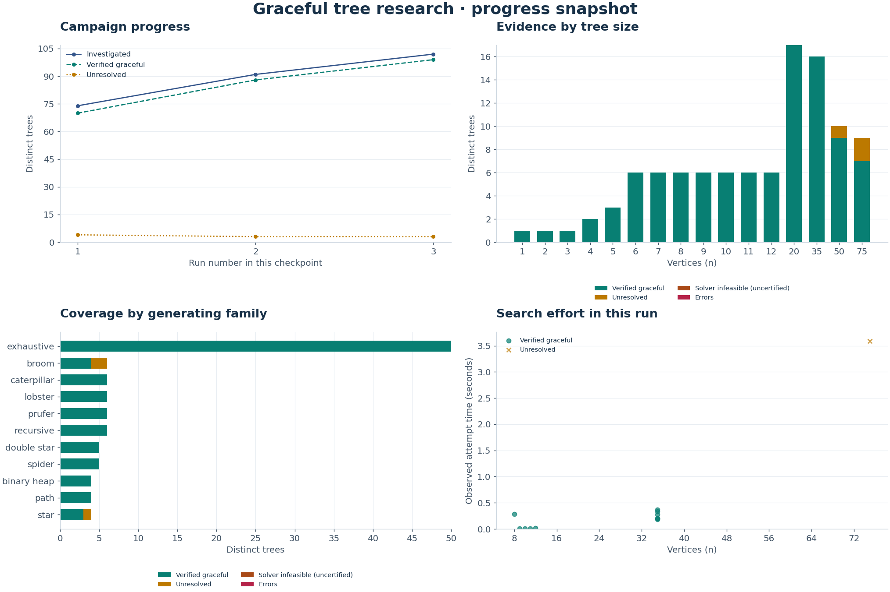

# Autonomous graceful tree research

A CPU-only, reproducible research system for the Graceful Tree Conjecture. It finds
and independently verifies positive labeling witnesses, keeps inconclusive searches
unresolved, and carries a cumulative research ledger between nightly GitHub Actions
runs. No LLM, personal API key, or paid compute service is required.

This is research software, not a proof of the conjecture. The literature already
reports exhaustive verification through 35 vertices. Our small exhaustive runs
validate the implementation; they do not improve that bound. Read the
[research summary and references](docs/research.md) before interpreting results.

The [initial validation record](docs/validation.md) includes actual experiment
counts and downloadable, reproducible run archives.

Every run also produces an **offline visual progress report** (`report.html`),
SVG charts, a PNG overview, and audited chart data (`progress.json`). It shows
cumulative progress across resumed runs and clearly distinguishes verified
labelings from unresolved searches and uncertified solver conclusions.

[Download an audited example visual report](examples/visual-progress.zip) and open
`report.html` after extraction. This is a saved local validation campaign, not a
live display of the cloud campaign.



Cloud execution is active in [GitHub Actions](https://github.com/tayre/tayre.github.io/actions/workflows/graceful-research.yml).
The [first hosted research run](https://github.com/tayre/tayre.github.io/actions/runs/42497916313)
completed successfully, including independent auditing and checkpoint/report uploads.
Nightly runs use a 30-minute budget; configuration pushes run a two-minute check.

**Usage review:** Technical activation does not establish GitHub approval of an
ongoing mathematical discovery campaign. Before increasing hosted research runs,
see the [GitHub Actions purpose and usage review](docs/github-actions-usage.md).
Software CI and sustained discovery compute have different purposes.

## Quick start

Use **CPython 3.12.14**, matching the cloud workflow. Python 3.11–3.13 is allowed by
the package, but the checked-in dependency lock and CI are tested on 3.12.

```sh
cd graceful-trees
python3.12 -m venv .venv
source .venv/bin/activate
python -m pip install -r requirements.lock
python -m pip install --no-deps --no-build-isolation -e .
python -m pip check
python -m pytest -q

graceful-research run --config configs/smoke.json --output results/smoke
graceful-research audit results/smoke
```

Every run requires a new, empty output directory. Existing evidence is never
overwritten. Continue a campaign by copying its checkpoint into a new run:

```sh
graceful-research run --config configs/nightly.json --output results/night-2 \
  --resume results/night-1/research.sqlite
```

Available configurations:

| Configuration | Purpose |
| --- | --- |
| `smoke.json` | One-minute mixed-family trial; small trees and sampled orders 12 and 20 |
| `exhaustive-small.json` | All 95 non-isomorphic trees of orders 1–9, plus bounded edge probes |
| `nightly.json` | 30-minute budget; exhaustive streams through order 12 interleaved with sampled orders 20, 35, 50 and 75 |
| `edge-profiles.json` | Small exhaustive inputs with more compute reserved for prescribed maximum-difference edge experiments |

`--budget-seconds`, `--max-cases` and `--seed` override JSON settings. Decreasing the
budget also reduces the finalization reserve to at most 10% of the budget.
Generation settings, the NetworkX version and the master seed must match a restored checkpoint. Change
the campaign and start fresh when changing the generator's input space. Solver
budgets, retry quotas and probe settings may change on resume.

## Mathematical model and verification

For each vertex `v`, CP-SAT assigns `x[v]` in `0..n-1`. All vertex labels are
different. For each edge `uv`, it assigns `d[uv] = abs(x[u]-x[v])` in `1..n-1`, and
all differences are different. This is precisely the definition for a tree.
The singleton is handled explicitly by the empty edge set.

Two optional, justified reductions are used: the implied difference-sum equation,
and choosing `x[0] < x[1]` from each complement pair. The proof and the scope of
this symmetry reduction are in [research.md](docs/research.md). No arbitrary
root-zero or extreme-edge location restriction is added to the main experiment.
The solver uses one search worker, a logged seed, and `symmetry_level=0`.

Every returned labeling is checked in the worker **and again in the parent** by
[`verify.py`](src/graceful_research/verify.py). It uses only the Python standard
library and checks connectivity, simplicity, edge count, the exact vertex-label
permutation, the exact difference permutation, and any declared probe restriction.
It can be run without installing NetworkX or OR-Tools:

```sh
python3 -S results/smoke/verify.py results/smoke/certificates
```

| Status | Meaning |
| --- | --- |
| `verified_graceful` | A positive witness passed the independent verifier; restricted attempts also satisfy their declared restriction |
| `solver_infeasible` | CP-SAT returned INFEASIBLE for the exact saved model; no independent UNSAT certificate has been checked |
| `unknown` | No conclusion, including timeouts, cancellation, or solver UNKNOWN |
| `model_invalid`, `invalid_solution`, `error`, `integrity_error` | An implementation/operational problem; the run fails and retains evidence |

CP-SAT v1 integration does **not** export a checkable infeasibility proof. The report's
independently certificate-verified infeasible count is therefore always zero.
No result is automatically called a counterexample. Unrestricted solver-infeasible
inputs receive priority for repeat searches with both optional reductions disabled,
but repeated CP-SAT answers still do not constitute an independent proof.
Contradictory positive and infeasible results for the same scoped input fail the run.

The secondary experiment computes partial information about
`E_max(T) = {uv : a graceful labeling can put difference n-1 on uv}`.
One representative per exact edge orbit is tested. An infeasible prescribed edge
does not imply an infeasible tree. The central edge of the four-vertex path is an
intentional negative control, not a discovery or a counterexample to the conjecture.

## Cloud execution

The workflows live at the repository root:

- [graceful-research.yml](../.github/workflows/graceful-research.yml): nightly at
  **06:23 UTC**, plus manual **Run workflow** with experiment and budget inputs.
  Changes to this workflow or `configs/nightly.json` on `master` also start a
  **two-minute** validation run using the nightly campaign and its checkpoint.
- [graceful-ci.yml](../.github/workflows/graceful-ci.yml): tests on changes to this
  project and its workflows, including an installed-CLI experiment and audit.

To activate the configured workflow, put these files and this project on the
repository's **default branch**, enable GitHub Actions under **Settings → Actions**,
and allow the pinned official `actions/checkout`, `setup-python`, and
`upload-artifact` actions. The initial push to `master` starts the two-minute
validation run automatically. **Actions → Graceful tree research → Run workflow**
can start another run with the selected budget. Local creation of these files does
not activate the schedule; a pushed default-branch workflow is required. If using
a default branch other than `master`, update the push branch filter as well.

Each job uses a standard `ubuntu-24.04` CPU runner, installs exact dependencies,
runs the tests, restores the latest successful checkpoint for that campaign and
branch, performs the experiment, audits the evidence, and uploads:

- `graceful-results-RUN_ID-ATTEMPT`: complete report, current-run evidence, source
  snapshot, metadata, cumulative SQLite ledger, and offline visual report with
  exportable figures. Attempted even after failure.
- `graceful-checkpoint-CAMPAIGN`: ledger and checksum metadata, uploaded only after
  successful execution and audit. The next run restores it automatically.

The automatic short-lived `GITHUB_TOKEN` is used only to read previous artifacts;
no secret setup or personal access token is needed. Permissions are `contents: read`
and `actions: read`. Successful push-triggered checkpoints are eligible for the
next nightly run, so initial progress is retained. Research runs for the same
branch are serialized. Dispatch
values are validated as data, not interpolated into shell commands. Workflow inputs
allow 1–30 compute minutes; the enclosing job limit is 45 minutes to allow setup,
tests, finalization and artifact uploads. The 30-minute research budget includes
generation, worker startup, solver work and a finalization reserve, not package
installation or the separate validation suite.

Standard hosted runners are [free for public repositories](https://docs.github.com/en/billing/concepts/product-billing/github-actions).
Private repositories consume included allowances; artifact storage is subject to
the account's limits. This project does not enable paid spending. Both research
artifacts retain **14 days** to bound repeated checkpoint storage. Each new
checkpoint contains all earlier inputs, attempts and witnesses, so history is carried
forward while runs continue. Download important artifacts for permanent archiving.
After a gap longer than retention, restore an archived ledger manually; artifacts
are not permanent storage. Monitor artifact size and account quotas as the ledger grows.

GitHub may delay scheduled jobs and [disable public-repository schedules after
60 days without repository activity](https://docs.github.com/en/actions/reference/workflows-and-actions/events-that-trigger-workflows#schedule).
Enable the workflow again if that occurs. A nightly schedule is not a guarantee
that a job ran; check Actions history. There is no automatic commit or issue posting.

## How budgets, progress and priorities work

The parent process owns a monotonic deadline. CP-SAT gets an individual time limit,
and a separate process supervisor enforces the outer limit even if native solver
code stalls. A persistent worker amortizes imports. SIGINT/SIGTERM stops new work,
terminates the worker and writes the report. A hard OS kill can prevent finalization,
but already committed SQLite transactions remain; workflow artifacts are still
attempted where GitHub permits them.

The scheduler reserves configurable shares for retries and restricted probes, while
guaranteeing a share for new cases. Cases with no completed attempt or with reported
infeasibility have highest retry priority; unknowns follow, favoring fewer previous
attempts and longer observed searches. Total attempts per case are capped to prevent
one unresolved tree consuming every night. The ledger retains cases past that cap
for manual replay. The run can finish early when its case limit, generation limit,
or finite sources are exhausted; it does not spend idle time just to fill a budget.

Generators are interleaved round-robin. Enumeration uses NetworkX's free-tree
generator with a special singleton case. Larger sources include uniform labeled
Prüfer trees, recursive trees, paths, stars, binary heap trees, spiders, caterpillars,
lobsters, brooms and double stars. Families overlap. Exact center/root tree encodings
deduplicate them, with a full encoding comparison to detect a hash collision.
The saved graph's vertex numbers remain the witness's vertex numbers.

Sampling labeled Prüfer trees is **not** uniform over isomorphism classes; rejection
of duplicate classes does not repair that bias. Structured samples have their own
biases. Enumeration is guarded at order 16 and sampled trees at order 256 to keep
preprocessing manageable. Runtime cutoffs make completed samples machine dependent,
even though each individual generated input and solver seed is reproducible.

## Reviewing and reproducing evidence

In the Actions run summary, use **Download the complete results artifact**, extract
the ZIP, and open **`report.html`** in a browser. It works offline without a server,
API key, CDN, or external font. A snapshot is generated after each run; it is not a
live view of a running solver. Keep the extracted files together to follow links to
the audit, inputs, CSV, and written report.

The visual report includes:

- Cumulative distinct trees and verified witnesses across the checkpoint's runs.
- Stacked outcomes by tree size and first introducing generator.
- Every unrestricted attempt's observed runtime in the current run, including
  unresolved observations and retries.
- A family-and-size filter for the cumulative comparison table, difficult current
  cases, and exact run-history counts.

Retries do not count as new trees. A verified witness is retained if a later retry
is unresolved. Restricted probes stay separate from unrestricted tree outcomes.
There is no percentage-complete indicator for an infinite conjecture. The audit
reconstructs `progress.json` directly from the cumulative ledger, and checksums
cover the HTML and figures. Matplotlib renders CPU-only SVG and PNG files with no
GUI. A reusable temporary font cache avoids rescanning fonts during shutdown.

Read `report.md`, then `analysis.json` for the full scientific context. The latter explicitly separates
observations, proposed experiments/hypotheses, and mathematical proofs (none are
generated). The rule-based analyzer groups by family **and order**, flags large
branch-count outliers within an order, and exposes censored searches. Its solved-only
runtime medians are not unbiased population estimates or significance tests.

Useful files in every run:

| File | Contents |
| --- | --- |
| `report.html` | Offline visual report with embedded charts and family/size filters |
| `progress.json` | Audited cumulative counts, run history, chart series and current-run runtime points |
| `figures/*.svg`, `figures/overview.png` | Standalone exportable charts and a combined PNG overview |
| `manifest.json`, `config.json`, `dependencies.txt` | Exact Python/dependency versions, OS/CPU, Git revision and dirty status, actual source hashes, configuration, seeds and cursors |
| `inputs/ID.json` | Original numbered edge list, exact isomorphism encoding, generator index/seed and structural features |
| `attempts.jsonl`, `attempts.csv` | All attempts in this run, scope, seeds, model options, results, runtime, branches/conflicts and verifier output |
| `attempts/NNNNNN/` | Request, result, CP model, explicit solver parameters, and response protobuf text when available |
| `certificates/` | Independently checkable positive labelings from this run |
| `research.sqlite` | Cumulative cases, generation cursors, run provenance and all attempts/witnesses across resumed runs |
| `source/`, `verify.py` | Actual source snapshot and standalone verifier |
| `checksums.json`, `checkpoint.json` | Transport-integrity hashes, not mathematical proof certificates |
| `audit.json` | Result of a subsequent audit |

Reproduce an exact saved attempt, or give it a longer limit:

```sh
graceful-research replay results/smoke/attempts/000001/result.json --output results/replay
graceful-research replay results/smoke/attempts/000001/result.json --output results/retry --seconds 120
```

Use the original `source/` snapshot and locked environment to replay old results.
Single-worker search and seeds improve reproducibility; wall times and time-limited
outcomes can change with CPU, OS, solver version, or surrounding load. OR-Tools
defaults are determined by the recorded exact version; all overridden parameters
are saved. Model text is an input artifact, not an UNSAT certificate.

`graceful-research audit` also reverifies every historical positive labeling in
the cumulative ledger, including witnesses from earlier nightly runs.

Inspect cumulative evidence with SQLite, for example:

```sql
SELECT scope, status, COUNT(*) FROM attempts GROUP BY scope, status;
SELECT tree_id, n, family FROM cases ORDER BY n DESC LIMIT 20;
SELECT data FROM attempts WHERE scope = 'graceful' AND status = 'solver_infeasible';
```

On a suspected unrestricted infeasible result: first check the numbered input and
model domains, rerun without reductions and with a fresh seed, compare an independent
SMT/backtracking implementation, then implement or commission a proof-logging SAT
encoding and independently validate its certificate. Preserve the original evidence.
Publish a counterexample claim only after independent mathematical investigation.

## Architecture and extension points

```text
configs → TreeStream → exact deduplication → SQLite inputs/cursors
                         ↓                       ↑
                   budgeted scheduler → isolated CP-SAT worker
                         ↓                       ↓
                   parent verifier ← positive witness
                         ↓
             attempts + certificates → rule-based analysis → Markdown/JSON/CSV
                         ↓
                audit → GitHub artifact → next night's checkpoint
```

`config.py` validates experiments; `trees.py` generates and identifies trees;
`solver.py` owns the model; `worker.py` enforces process deadlines; `verify.py`
checks witnesses independently; `storage.py` owns transactional persistence;
`runner.py` schedules work; `analysis.py` reports; `audit.py` checks exported evidence.
`progress.py` derives visual data from the ledger; `visuals.py` renders the offline
report and Matplotlib figures.
The small scripts under `scripts/` adapt the same CLI to GitHub.

`HypothesisProvider` is a typed interface for future optional LLM assistance. Such a
provider consumes the analysis summary and proposes questions; it must never modify
evidence classifications or be required by nightly execution. The default is fully
deterministic and makes no novelty claims.

For longer compute, run the same CLI with a larger `--budget-seconds` and durable
volume on a CPU VM or batch job. Add deterministic input shards and a central ledger
before distributing workers; do not let multiple jobs mutate one SQLite file or
independently advance the same cursor. For a solver upgrade, benchmark identical
saved inputs and retain both environments. For generator or canonical-encoding
changes, increment their schema version and start/migrate a campaign explicitly.

Useful next research work is controlled algorithm comparison, complete small
extreme-edge profiles with independent UNSAT certification, and precisely stated
family-specific extension properties. Check the literature before describing any
pattern as novel. Numerical coverage, however large, is not a universal proof.

## Validation

```sh
python -m ruff check src tests scripts
python -m ruff format --check src tests scripts
python -m pytest -q
graceful-research run --config configs/exhaustive-small.json --output results/exhaustive
graceful-research audit results/exhaustive
```

Tests compare the exact model against independent permutation enumeration through
order six, with both optional reductions enabled/disabled and all edge-orbit probes.
They compare tree/edge encodings with relabelings and explicit automorphisms, reject
malformed witnesses, exercise checkpoint continuation, audit tampering, deadlines,
worker failures and signal termination, and validate the cloud workflow contracts.
