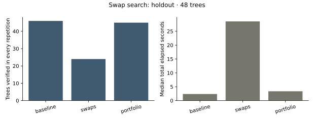

# Performance measurements — 8 November 2026

## Label-swap search experiment

**The nightly default remains `portfolio-frontier-v3`.** The new swap search is
available explicitly, but its portfolio lost a success on the independent holdout.
All methods below use the same one-second complete attempt allowance and unchanged
CP-SAT fallback. The candidate allowance remains at most 0.1 seconds.

| Complete route | Verified in every repetition | Unresolved | Median total seconds |
| --- | ---: | ---: | ---: |
| Existing v3 + exact fallback | 46 / 48 | 2 | 2.371 |
| Targeted swaps + exact fallback | 24 / 48 | 24 | 28.563 |
| v3 then targeted swaps + exact fallback | 45 / 48 | 3 | 3.363 |



The portfolio's lost case is a 75-vertex lobster, case 43. In its first repetition,
v3 found a labeling in about 0.056 seconds; the new portfolio stopped v3 at its
reserved 0.05-second share, and neither swaps nor exact fallback finished in the
remaining time. This occurred in every repetition. There were no gained cases.
All 45 portfolio candidate successes came from its v3 stage; swaps supplied no
additional portfolio witness in this corpus. Standalone targeted swaps found 11
witnesses per repetition, with exact fallback supplying the other 13 successes.

Development used the earlier 48-tree portfolio corpus. Uniform proposals verified
one case consistently with the missing-sum objective and zero with missing-count.
One targeted proposal policy was then developed: introduce a selected absent
difference with probability 3/4 per proposed move, retaining uniform proposals for
escape. On the same development corpus it verified 10 cases with missing-sum and
one with missing-count. Those observations selected missing-sum and the targeted
policy **before** the fresh holdout was generated and measured. The initial source
snapshot is retained, including the earlier implementation before the extra indexes.
There was no tuning after holdout results.

The holdout contains 48 unique non-caterpillar trees: six per family (Prüfer,
recursive, spider, lobster) and order (35,75), excluding all four previous benchmark
corpora. Three repetitions rotate route order. Candidate work limits are explicit:
40,000 v3 nodes or swap proposals for individual routes, and 40,000 of each for
the portfolio. These operations are not equivalent; the comparison is equal-time.
Every positive witness was independently verified, and every fallback hash matched
the original exact model. Imports were warmed; no project tests or other project
CPU-heavy tasks ran during timing. The measured environment is macOS ARM64,
CPython 3.12.14, NetworkX 3.5 and OR-Tools 9.14.6206.

These are censored timings on a small structured sample, not predicted nightly
throughput or a comparison against published implementations. The result does not
rule out swaps at longer budgets or with a different policy. Such work should use
development inputs and a new independent holdout. Increasing nightly compute or
replacing v3 is not justified by these measurements.

The [summary and all holdout inputs](../examples/swap-benchmark.json),
[complete experiment archive](../examples/swap-experiments.zip), and
[method/reproduction details](techniques.md#label-swapping-and-a-complementary-portfolio)
preserve both the initial weak result and the failed portfolio improvement. The
archive contains each development phase and the holdout, full trajectories,
requests/results, witnesses, source snapshots, versions, checksums and visual reports.

## Exact leaf completion experiment

The opt-in `leaf-portfolio-v4` passed correctness checks but lost one success on
a new 48-shape corpus: **45/48 versus 46/48** for v3, with median total time
**3.718 versus 2.486 seconds**. On 5,112 frozen residual visits, the exact rule
also cost more than ordinary branching; most tails had only one or two leaves.
The nightly default remains v3. Full protocols, source hashes, inputs and negative
measurements are retained in [leaf-tail.md](leaf-tail.md).

## Residual-state portfolio

The subsequent technique review found that memoization, label-capacity pruning
and central roots complement the original candidate search. Replacing v1 outright
regressed on the genuinely unseen subset of its first evaluation. The deployed
portfolio therefore keeps v1 first and tries the second method in the same shared
wall allowance. A separate 48-tree evaluation excluded all earlier tree shapes:
**47 rather than 43 verified cases**, with median capped-workload time **1.413 rather
than 5.236 seconds** across three repetitions (**3.71×** on that workload).

See [techniques.md](techniques.md) for the prior work, failed replacement experiment,
component ablations, proofs, exact inputs and limitations. These comparisons use
different corpora from the historical passes below; do not multiply their ratios.

## Bounded frontier search

The second pass adds an incomplete descending-difference witness search before
CP-SAT and computes structural cores without copying NetworkX graphs. The exact
model is unchanged. Each candidate must pass the existing independent verifier;
search exhaustion is never an infeasibility claim. See the
[algorithm and limits](research.md#bounded-frontier-witness-search).

The paired benchmark uses 60 input cases: ten families at orders 35 and 75, each
with input seeds `20261108`, `104729`, and `130363`. There are **47 distinct tree
isomorphism classes**; deterministic families repeat across input seeds. Solver
seeds are logged separately. Each variant uses the same cases, exact-model options,
one-second attempt allowance and three repetitions, with execution order reversed
on alternate repetitions. Imports are warmed and no project tests ran concurrently.
The baseline already includes the first pass's direct caterpillar construction.

Measured on macOS 15.7.7 ARM64, CPython 3.12.14, NetworkX 3.5 and OR-Tools 9.14.6206:

| Measurement | Previous route | With frontier search |
| --- | ---: | ---: |
| Median time for 60 input cases | 18.430 s | 6.354 s |
| Verified cases in every repetition | 45 / 60 | 54 / 60 |
| Unresolved cases in every repetition | 15 / 60 | 6 / 60 |
| Cases requiring CP-SAT | 30 / 60 | 7 / 60 |
| Verified order-75 cases | 15 / 30 | 24 / 30 |

This is **2.90× faster for this capped workload**, with nine additional verified
cases. Thirty cases use the unchanged caterpillar construction; 23 are solved by
the frontier search and one by exact fallback. The six remaining cases include
all three order-75 Prüfer samples, two binary-heap cases and one recursive-tree
case. Results are consistent across the three repetitions, but the sample is small
and structured. A short failed prepass also consumes time that CP-SAT would
otherwise have received, so individual cases can regress near a cutoff.

Separately, 150 complete structural-feature calculations took a median **0.09314 s**
with copied/pruned graphs and **0.04041 s** with direct core degrees: **2.30× faster**.
The workload comprises the same ten families at orders 35, 75 and 256, five passes
per repetition, with identical full feature dictionaries required for every input.

These are measured processing costs for fixed, bounded workloads. Unknown results
are censored, not measured solution times. Neither ratio estimates nightly
throughput or performance on arbitrary trees, and the two speedup ratios must not
be multiplied. Archive auditing, report rendering, generation and checkpoint I/O
are outside the search timing. The heuristic does not establish a new verification
bound, a counterexample, or a new mathematical theorem.

Reproduce this pass with:

```sh
python scripts/benchmark_frontier.py --output results/frontier-benchmark --attempt-seconds 1 --repeats 3
```

The output must be new. Every positive witness is independently verified, and each
request/result is retained along with exact inputs, versions, source snapshots and
checksums. [Saved measurements](../examples/frontier-benchmark.json) include the 60
inputs, all 360 attempt records, repetition totals and source hashes. The full local
archive is `results/frontier-benchmark-v1/`. Its recorded Git commit is the base
before the uncommitted optimization; the source hashes identify what was measured.
This benchmark archive is not a campaign checkpoint for `graceful-research audit`.

`frontier_search` is enabled by default and explicitly in the nightly configuration.
The v1 `frontier_max_nodes` was 20,000; the current portfolio permits 20,000 per
stage, 40,000 in total, within the same wall allowance. Seeds and node limits make the search order
reproducible; wall cutoffs can still vary by machine. Changing these options does
not reset generation or rewrite earlier chart history. Restricted and SAT attempts
skip the prepass. No additional exact-model constraint needs a new Lean proof;
the existing proofs and independent certificate checks remain in use.

## First pass: caterpillar construction and diameter

The optimized path uses the established caterpillar construction before CP-SAT,
and computes tree diameters with two breadth-first sweeps. It also defers loading
OR-Tools until an attempt needs the solver. No solver constraints, generation
streams, canonical tree IDs, time limits or independent verification checks were
weakened. See the [construction invariant](research.md#direct-witnesses-for-caterpillars).

### Paired measurements

Measured on macOS 15.7.7, ARM64, CPython 3.12.14, NetworkX 3.5 and OR-Tools
9.14.6206. The workload contains one input from each of the ten configured
families at orders 35 and 75: **20 fixed trees**, repeated three times per variant,
with a one-second CP-SAT limit and the same logged seeds. Execution order
alternates between repetitions; solver imports are warmed for both variants.
There was no concurrent project test run during these measurements.

| Measurement | Before | Optimized |
| --- | ---: | ---: |
| Median total time for the 20-tree capped search workload | 13.406 s | 6.105 s |
| Verified trees in each repetition | 9 / 20 | 15 / 20 |
| Unresolved trees in each repetition | 11 / 20 | 5 / 20 |
| Median time for 150 diameter calculations | 0.6212 s | 0.01098 s |

That is **2.20× faster for this capped search workload** and **56.6× faster for
the diameter calculation alone**. The ten caterpillar-family inputs all receive
verified witnesses from the construction; their median in-process attempt time
is 0.296 ms, including verification and method-file output. Non-caterpillars still
use the existing solver. Six additional verified trees were previously unresolved
at the one-second limit; this is an algorithm improvement on known graceful
families, not new mathematical evidence against or beyond established results.

The diameter workload uses all ten families at orders 35, 75 and 256, five passes
per repetition. Both algorithms returned identical integers for every input.
This phase times diameter calculation only, not the full research pipeline.

These ratios are observations for this machine and workload, not forecasts for a
nightly run or an estimate of time to solve arbitrary trees. Unknowns are censored;
we do not substitute the time limit for an actual solution time. Smaller exhaustive
cases, non-caterpillar-heavy workloads, report generation and checkpoint I/O can
have different speedups. The lazy-import saving is not included in these ratios.

### Reproduction and evidence

```sh
python scripts/benchmark.py --output results/benchmark --attempt-seconds 1 --repeats 3
```

The output must be a new directory. `benchmark.json` records each outcome and
duration, seeds, exact dependency versions and machine information. Per-attempt
directories contain inputs, options and verified labelings; CP-SAT attempts also
retain their model, parameter and response protos. The benchmark checks every
positive witness independently and retains a source snapshot and checksums.
It is a benchmark archive, not a campaign checkpoint for `graceful-research audit`.

The checked-in [measurement summary](../examples/optimization-benchmark.json)
contains the raw repetition totals, versions and hashes of the measured source.
The full local evidence is in `results/optimization-benchmark/`. The recorded Git
commit is the base before the optimization; the file hashes identify the code
actually measured. Repeat runs may produce different timings and cutoff outcomes.

### Validation and reporting

- 319 Python tests and 19 dashboard tests passed. The fast algorithms were checked
  on all 201 non-isomorphic trees through order 10, and on larger generated and
  relabeled trees through order 256.
- The end-to-end smoke run verified 100 unrestricted trees and produced 25 edge
  probes. Four probes were solver-infeasible; no unrestricted tree was infeasible
  or unresolved. Its independent audit accepted all 121 positive certificates.
- Restricted negative controls used CP-SAT in this benchmark; nightly probes now use SAT with proof checking. Invalid constructed witnesses
  fail verification, and non-caterpillars fall back to the original model.
- Reports record `search_method`; construction has no invented solver time,
  branch count or infeasibility proof. CP-SAT medians and outlier baselines exclude
  constructed witnesses. History counts retain their existing schema.

`constructive_search` is enabled by default and explicitly in the nightly config.
Set it and `frontier_search` to `false` to benchmark CP-SAT alone. Changing either
does not reset the campaign.
Replay of a legacy request without this field still uses CP-SAT. The existing
nightly budget and schedule are unchanged.
