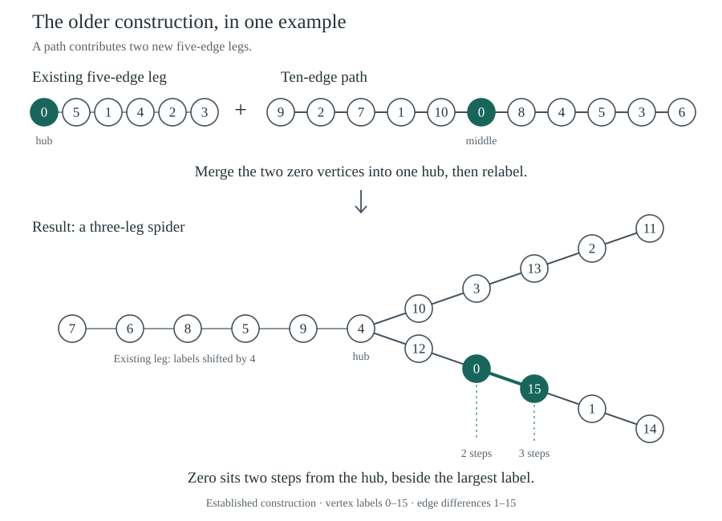

# Five-edge spider: prior-work implication

Literature and derivation check, **14 November 2026**.

**Conclusion:** the five-edge symmetric-spider property follows from established
graceful-graph constructions. We should not present it as a new theorem. This
replaces the earlier assessment that novelty was merely unconfirmed.

The decisive evidence is a short specialization of an existing vertex-amalgamation
construction. It gives both zero at depth two and the maximum label at adjacent
depth three, for every leg count. We did not find an earlier paper explicitly
stating this exact corollary or printing our hub-label-one formula. Neither is
needed for the prior-work implication. The formula, implementation and Lean
certificate remain useful; their validity does not establish mathematical novelty.

## Exact claim being compared

Write `S(k,5)` for `k` paths of **five edges** meeting at their common hub. It has
`5k+1` vertices. The interior-extreme claim is that there is a graceful labeling
with zero at depth two on a leg and `5k` at depth three on that same leg.
Complementation gives zero at depth three. Together with the known outer
positions, every vertex can receive zero in some labeling: 0-rotatability.

“Five legs,” “five vertices per path,” ordinary gracefulness, and zero only at
the hub are different statements. The comparison below keeps these distinctions.



**Three-leg example.** The two zero vertices become a single hub; no connecting
edge is added. Relabeling gives the hub 4 and puts 0 beside 15 at the two inner
positions. Every leg still has five edges. [Open the diagram at full size](../examples/five-spider-prior-art-diagram.svg).

## The established construction

[Wu and Lu (2012)](https://combinatorialpress.com/article/ars/Volume%20106/volume-106-paper-20.pdf),
*On the Constructions of New Families of Graceful Graphs*, Ars Combinatoria 106,
235–246, describe vertex amalgamation in Theorem 3.1, printed pp.239–240.
That theorem is stated for two α-labelings; the paragraph on **p.242 immediately
before Theorem 3.6** explicitly extends the constructions when one labeling is
only graceful. The scanned statement and extension were read directly.

[Bell and Cummins (2019)](https://ajc.maths.uq.edu.au/pdf/75/ajc_v75_p343.pdf),
*Graceful pairings*, pp.353–354, restate this ordinary-graceful-plus-α result and
display its relabeling. Their Proposition 4.4 strengthens the conclusion to
“gracious” under an additional assumption; we need only the ordinary graceful
conclusion, not that additional assumption. They also attribute the older
construction to Huang, Kotzig and Rosa (1982), Lemma 2.1. We verified the 2012
and 2019 texts, not the full 1982 original.

In the notation used here, let `G` have `m` edges and a graceful labeling `g`
with a chosen vertex labeled zero. Let `H` have `n` edges and an α-labeling `f`
with boundary `s`: every edge joins a label at most `s` to a label greater than
`s`. Identify the two zero vertices. The resulting labeling is

```text
on G:                  g + s
on H where f <= s:     s - f
on H where f > s:      m + n + s + 1 - f.
```

Both identified vertices receive `s`. Differences within `G` are unchanged;
each difference `d` of `H` becomes `m+n+1-d`. This construction is the prior
result being specialized, not a construction invented by this project.

## Explicit specialization to five-edge legs

For `k >= 3`, take `G = S(k-2,5)`, so `m = 5(k-2)`. A graceful labeling with
the hub zero is already known for symmetric trees; see Stanton–Zarnke's result
as stated in [Superdock, Theorem 2.22](https://arxiv.org/html/1403.1564v1),
and [Rofa, Theorem 1, printed p.6](https://arxiv.org/pdf/2312.16235).

For `H`, use the following path, **ten edges and eleven vertices**, written from
one endpoint to the other:

```text
vertex labels:     9, 2, 7, 1, 10, 0, 8, 4, 5, 3, 6
edge differences:    7, 5, 6, 9, 10, 8, 4, 1, 2, 3
```

Its labels are exactly `0..10`, its differences exactly `1..10`, and every edge
crosses the boundary `s=4`. Its central vertex is zero. Identifying that center
with the hub of `G` adds two five-edge legs, giving exactly `S(k,5)`.

The established relabeling becomes

```text
on G:                  g + 4
on H where f <= 4:     4 - f
on H where f > 4:      m + 15 - f.
```

The resulting two new legs, listed outward from their common hub **4**, are:

| Leg | Labels from the hub outward |
| --- | --- |
| Left | `(m+5, 3, m+8, 2, m+6)` |
| Right | `(m+7, 0, m+10, 1, m+9)` |

The right leg therefore has **zero at depth two** and **`m+10 = 5k` at depth
three**. This is the full interior-extreme property of our displayed formula,
not merely ordinary gracefulness or a weaker prescribed-root result.

For completeness, the vertex ranges are `0..4` on the path's low part,
`4..m+4` on `G`, and `m+5..m+10` on the path's high part. Only the identified
hub shares label 4. The differences of `G` are `1..m`; the path's differences
are `m+1..m+10`. Thus all required vertex labels and differences occur exactly
once, for every applicable `m`, not just checked numerical examples.

For `k=2`, the same calculation works with `G` a singleton and `m=0`. For
`k=1`, the six-vertex path `(1,4,0,5,3,2)` has differences `(3,4,5,2,1)` and
the requested interior extremes. Complementation and permutation of equal legs
give either interior zero position on any leg. For proper spiders, Rofa's
Corollary 2, printed p.12, covers depths `0,1,4,5`; paths are already known to be
0-rotatable. This completes the prior-work derivation of the full claim.

This derivation was independently checked by three reviewers in this session,
including two independent checks of the original 2012 extension. These were
AI-assisted checks, not external specialist review. The fixed path and relabeling
checks are saved in [machine-readable evidence](../examples/five-spider-prior-art.json).
Finite checks support the arithmetic; the range argument above is universal.
The existing Lean proof verifies our original formula, not this amalgamation proof.

The [standalone checker](../scripts/check_spider_prior_art.py) verifies 103 leg
counts (`1..100`, 256, 1,000 and 10,000), including treehood, exact label and
difference sets, interior extrema and complemented witnesses. Its old-component
formula is the known hub-zero symmetric-tree construction, shifted by four;
it does not call our hub-one constructor. Reproduce from `graceful-trees/`:

```sh
python3 -S scripts/check_spider_prior_art.py --output /tmp/five-spider-prior-art.json
```

Use a new output filename; the checker refuses to overwrite existing evidence.

## Other literature examined

| Source | Relevant scope and outcome |
| --- | --- |
| [Patterson, master's thesis (2017)](https://cardinalscholar.bsu.edu/server/api/core/bitstreams/b44ff232-a480-4d64-aa44-8dff4535e28c/content) | Theorem 3.2.1, printed p.11, gives a proof of graceful-plus-α amalgamation. Section 5.4 and Appendix A.3 discuss rotatability and small-spider data, not an arbitrary-leg five-edge theorem. This older thesis is another route to the decisive construction. |
| [Rofa, arXiv:2312.16235v1 (2023)](https://arxiv.org/abs/2312.16235) | Corollary 2 gives four outer levels; Corollary 3 covers legs of length at most three. Section 4 asks about longer legs. This question does not rule out corollaries of earlier constructions. |
| [Panpa, Imnang and Wasuanankul (2025)](https://doi.org/10.1155/jama/5826777) | Theorems 3.2–3.4 treat hub-zero for three legs, leaf-zero for four legs, and gracefulness for five legs. These are not arbitrary numbers of five-edge legs with prescribed interior zero. |
| [Dumitru and Nacu, arXiv:2607.12597v2 (2026)](https://arxiv.org/pdf/2607.12597v2) | Theorems 3.3–3.5 concern self-matched leg packing. The displayed five-edge template puts zero at depth four; the extra-leaf corollary is not the pure uniform-spider claim. |
| [Shan and Zhong, arXiv:2605.14295v2 (2026)](https://arxiv.org/pdf/2605.14295v2) | The family hypotheses do not give the arbitrary-leg interior-zero claim directly. Theorem 2's direct path extension excludes length five (`5 = 1 mod 4`). This exclusion does not rule out amalgamation using a ten-edge path. |
| [Krop (2014)](https://arxiv.org/pdf/1402.3994) and [Superdock (2014)](https://arxiv.org/html/1403.1564v1) | Root-preserving uniform subdivision explains the earlier four-edge and six-edge midpoint cases. The coprime pairs `(5,2)` and `(5,3)` avoid that particular route, but do not avoid the different amalgamation route above. |

A related caution is [Niu's arXiv:2605.02303](https://arxiv.org/abs/2605.02303),
withdrawn in May 2026 because the three-edge-spider result followed from prior
work. Its obsolete abstract still appears in search summaries. That withdrawal
is not evidence about our proof; the explicit implication above determines our
assessment.

## Search coverage and remaining limits

The search used the exact target and variants: “symmetric spiders,” “uniform
spiders,” “subdivided stars,” “0-rotatable,” “0-ubiquitously graceful,” “movable
zero,” “five-edge,” prescribed roots, α-labelings, and graceful coalescence or
amalgamation. Backward references were followed from Rofa, Superdock, Patterson
and Bell–Cummins. Gallian's October 2026 survey served as a reference index;
the decisive statements were checked in primary texts. Searches also covered
Rofa follow-ups and the 2025–2026 spider papers above.

The citation search was not exhaustive: Google Scholar returned HTTP 429,
Semantic Scholar's redirect was unavailable, and the full text of Zhou–Yao–Cheng,
*On 0-rotatable trees* (2011), was not obtained. No authors were contacted and
no database-access or expert-priority certification is claimed. These gaps
could reveal further antecedents; they cannot remove the positive implication
already exhibited.

The particular hub-label-one formula may differ from this hub-label-four
construction. Its exact-formula priority and any independent advantage have not
been established. Retain it as an independently proved and formalized
construction, without promoting that difference into a new theorem claim.

Historical November 9 evidence archives retain their original text and checksums.
This review supersedes their inconclusive novelty metadata. Before proposing a
new leg-length target, check finite α-labeled path seeds and the resulting
amalgamation consequences as well as direct statements in the literature.
