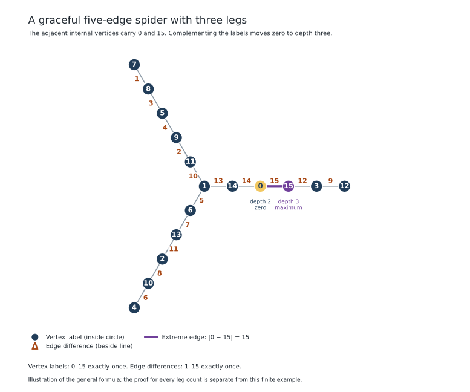

# Zero at any vertex of a five-edge symmetric spider

**Result, 9 November 2026:** every symmetric spider with five edges on each
leg is **0-rotatable**: each vertex can receive zero in some graceful labeling.
The explicit construction below supplies the two interior positions missing
from Rofa's stated first-two/last-two-level result. The remaining positions
follow from that published result. This is a proved family statement, not a
solution of the Graceful Tree Conjecture. A scoped literature review found no
matching prior construction; **novelty and priority remain unconfirmed**.

Let `S(k,5)` have hub `h` and legs
`h—v[i,1]—v[i,2]—v[i,3]—v[i,4]—v[i,5]`, for `1 <= i <= k`.
For every positive integer `k`, the following explicit graceful labeling places
`0` at `v[1,2]` and `5k` at `v[1,3]`. Complementation therefore gives a graceful
labeling with zero at distance three as well. Permuting the legs selects any
vertex in either of these two orbits.

This is a general algebraic result. Finite verification checks its implementation,
not its universal quantifier. Research priority is a separate literature question;
this proof does not assert that the result is new.



In this example, the edge between the internal labels 0 and 15 has the largest
difference. Replacing every label `x` by `15−x` moves zero to its other endpoint
without changing any difference.

## Formula

Set `f(h)=1`. When `k >= 2`, use:

| Leg | Labels from the hub outward |
| --- | --- |
| First, `i=1` | `(5k−1, 0, 5k, 3, 5k−3)` |
| Middle, `2 <= i <= k−1` | `(5k−5i+6, 5i−1, 5k−5i, 5i−2, 5k−5i+2)` |
| Last, `i=k` | `(6, 5k−2, 2, 5k−5, 4)` |

For `k=1`, use only the first-leg formula: hub `1`, leg `(4,0,5,3,2)`.
Its five weights are `(3,4,5,2,1)`, so it is graceful.

## All vertex labels occur exactly once

For `k >= 2`, split the labels by residue modulo five. The formula gives:

| Residue | Occurrences, in increasing label order |
| --- | --- |
| 0 | first depth two; middle depth three in reverse leg order; last depth four; first depth three |
| 1 | hub; last depth one; middle depth one in reverse leg order |
| 2 | last depth three; middle depth five in reverse leg order; first depth five |
| 3 | first depth four; middle depth four; last depth two |
| 4 | last depth five; middle depth two; first depth one |

The residue-zero row is exactly `0,5,...,5k`. Row `r`, for `1 <= r <= 4`,
is exactly `r,r+5,...,r+5(k−1)`. The middle segments are empty when `k=2`.
These five disjoint rows partition `0,...,5k`.

## All edge weights occur exactly once

The first leg's depth-two/depth-three edge has weight `5k`. The last leg's
hub edge has weight `5`. The middle hub edges have weights `5(k−i+1)`, for
`2 <= i <= k−1`. These are exactly the `k` positive multiples of five through `5k`.

Define two signed progressions, each with `2k` terms:

```text
Q[j] = 2 − 5k + 5j,   0 <= j <= 2k−1;
R[j] = 4 − 5k + 5j,   0 <= j <= 2k−1.
```

For the other `4k` edges, the following table lists a signed quantity whose
absolute value is the edge's weight. Choosing the sign only simplifies the
partition proof; weights themselves remain absolute differences.

| Edge | Signed quantity | Progression index |
| --- | ---: | ---: |
| First hub—depth one | `2−5k` | `Q[0]` |
| Last depth three—four | `7−5k` | `Q[1]` |
| Middle depth three—four | `5k−10i+2` | `Q[2k−2i]` |
| Middle depth one—two | `5k−10i+7` | `Q[2k−2i+1]` |
| Last depth one—two | `5k−8` | `Q[2k−2]` |
| First depth three—four | `5k−3` | `Q[2k−1]` |
| Last depth two—three | `4−5k` | `R[0]` |
| Last depth four—five | `9−5k` | `R[1]` |
| Middle depth four—five | `5k−10i+4` | `R[2k−2i]` |
| Middle depth two—three | `10i−5k−1` | `R[2i−1]` |
| First depth four—five | `5k−6` | `R[2k−2]` |
| First depth one—two | `5k−1` | `R[2k−1]` |

In each progression, the middle-edge indices are exactly `2,...,2k−3`: the
even indices from one middle-edge family and the odd indices from the other.
The four special edges supply the remaining indices. This remains valid for
`k=2`, when there are no middle edges.

All `Q` terms are congruent to two modulo five. They are nonzero and distinct;
two of them cannot be negatives of one another, since their sum would be
congruent to four modulo five. Hence their absolute values are `2k` distinct
positive integers, all at most `5k−2`, with residues two or three modulo five.
There are exactly `2k` such integers in `1,...,5k`, so they are precisely that set.

All `R` terms are congruent to four modulo five. The same argument applies:
opposite terms would sum to zero but have sum congruent to three modulo five.
Their `2k` absolute values, bounded by `5k−1`, are precisely the integers with
residues one or four modulo five in `1,...,5k`.

The multiples of five, `|Q|`, and `|R|` are disjoint and cover `1,...,5k`.
Together with the vertex-label partition, this proves gracefulness for every
`k >= 2`; the explicit `k=1` check finishes the proof.

## Moving zero to distance three

Set `f'(v)=5k−f(v)` for every vertex. This permutes the label set and preserves
every edge weight because `|f'(u)−f'(v)|=|f(u)−f(v)|`. Since `f(v[1,3])=5k`,
the complemented labeling has `f'(v[1,3])=0`. The two formulas therefore cover
both interior root orbits for every positive leg count.

The implementation is `five_edge_spider_internal_zero` in
`src/graceful_research/spider_construction.py`. Its default zero is at distance
two; `root_distance=3` selects the complemented labeling, and `root_leg`
selects the desired leg. The implementation also preserves the full tree and
an extreme-edge restriction for the independent standard-library verifier.

## Corollary: every vertex can receive zero

For a proper spider take `k >= 3`. Its six vertex levels have depths `0,...,5`,
and its daughter-degree sequence is `(k,1,1,1,1)`.
[Rofa's Corollary 2, printed page 12](https://arxiv.org/pdf/2312.16235)
supplies graceful labelings with zero at any vertex in the first two and last
two levels: depths `0,1,4,5`. The construction above and its complement supply
depths `2,3`. Permuting the equal legs covers every vertex at either depth.
All vertices are therefore covered. The new formulas themselves also work for
the degenerate path cases `k=1,2`; full 0-rotatability of paths is Rosa's known
result, reproduced as [Superdock's Theorem 2.3](https://arxiv.org/pdf/1403.1564).

This corollary concerns the *position of zero*. Ordinary gracefulness of these
trees was already known. One labeling need not work for several prescribed
zero vertices simultaneously.

## Literature boundary

The review checked the full statements of the following closely related work.
Absence from this list is not a proof of absence from the literature.

- [Rofa, 2023](https://arxiv.org/abs/2312.16235) gives the four outer level classes
  above and asks about 0-rotatability of longer symmetric spiders. The abstract's
  wording about all spiders must be read against the narrower full-text question.
- The rooted uniform-subdivision construction follows from the generalized
  exceptional-vertex construction described in
  [Krop, 2014, Theorem 2.4 and its following paragraph](https://arxiv.org/pdf/1402.3994)
  and [Superdock, 2014, Theorems 2.28–2.29](https://arxiv.org/pdf/1403.1564).
  With complementation, it preserves zero on an original vertex. It already
  resolves the midpoint targets at leg lengths four and six by subdividing
  length-two legs. Our earlier four-edge midpoint target was therefore a known
  corollary, not a gap. The pairs `(5,2)` and `(5,3)` have no common subdivision
  factor, so that route does not directly produce these positions.
- [Panpa, Imnang and Wasuanankul, 2025](https://doi.org/10.1155/jama/5826777)
  give constructions for specified small numbers of legs; their stated results
  do not supply these two positions for arbitrary leg count.
- [Dumitru and Nacu, 2026](https://arxiv.org/pdf/2607.12597) study packing of
  self-matched legs and additional leaves. Their displayed length-five pattern
  places zero at depth four; the construction here does not require each leg to
  be individually self-matched. No direct implication was found.

The theorem and proof should receive specialist review before any publication
or claim of first discovery. The next construction targets are primitive
length-seven positions, after applying known subdivision consequences; failure
of a particular formula search would not establish a negative result.

## Formal check and reproducibility

[`FiveSpider.lean`](../formal/Graceful/FiveSpider.lean), namespace `TwoInterior`,
defines the same formulas with zero-based leg and position indices. It proves
for every `k > 0` that the vertex list is a permutation of `0,...,5k`, and that
the list of **actual adjacent absolute differences** is a permutation of
`1,...,5k`. It also proves the two extreme labels, complemented label coverage,
and preservation of differences. No bound on `k`, admitted result, custom axiom
or `native_decide` is used. The file also verifies the earlier depth-two-only
construction retained in the Python module.

This formalization checks formula lists. It does not formalize graph treehood,
the Python implementation, leg permutation, or Rofa's four remaining root
classes. Thus the full 0-rotatability corollary combines the checked formula
arithmetic with the written graph argument and cited result. The
[formal audit](../examples/five-spider-proof.json) records the precise trust
boundary and compiler output.

From `graceful-trees/`, with the pinned environment and Lean toolchain:

```sh
python scripts/experiment_spider_construction.py --output results/spider-construction
python scripts/check_proofs.py --output results/spider-proofs
python -m pytest -q tests/test_spider_construction.py
```

The permanent finite experiment checks 338 full witnesses, including both
interior roots on trees with 10,000 legs (50,001 vertices), using the independent
tree/label/difference verifier and the declared maximum-edge restriction.
These checks validate implementation instances; the universal claim rests on
the proof above. Download the [summary](../examples/five-spider-construction.json)
and [complete evidence archive](../examples/five-spider-evidence.zip), including
inputs, labels, source snapshots, compiler logs and checksums.
