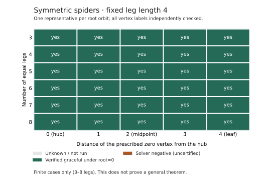

# Initial validation record

## Parallel follow-up experiments — 8 November 2026

Three independent tracks were implemented and exercised concurrently. The complete
suite passed **894 Python tests**, including four real Lean rejection tests, and
**26 dashboard tests**. Ruff lint and formatting checks passed. Cross-reviews found
no correctness blockers in the constructive lift, scoped solver, certificate checker,
formal implication or workflow. The nightly solver remains `portfolio-frontier-v3`.
These runs establish functional results; concurrent wall times are not speed evidence.

| Track | Finite result | Scope |
| --- | --- | --- |
| Perfect-matching contraction and lift | 28 verified labelings among 35 inputs; all 27 matching inputs and the singleton succeed | Known construction; seven controls lack perfect matchings |
| Prescribed-zero symmetric spiders | 40 witnesses and one tiny restricted solver negative across 41 probes | Includes all 30 root orbits for length-four spiders with 3–8 legs |
| Residual congruence certificates | 68 independently checked parity certificates among 77 impossible residuals; 25 feasible controls | Fixed boundaries and resources only |

The matching corpus includes 24 deliberately matching-rich generated trees at
orders 32, 64 and 128; every one received a verified witness. Every core and lifted
witness was independently checked, including matched-pair sums. Tests compare the
matching detector against NetworkX on all non-isomorphic trees through order 10
and cover work, node and time cutoffs. No comparative speedup is established.

The spider model disables complement symmetry breaking and fixes the selected
vertex to zero as the experiment's restriction. All six midpoint targets and
24 other root-orbit controls succeeded. Eleven tiny cases were also checked by
definition-level enumeration (486 permutations examined). The single negative,
with leg lengths `[1,1,3]` and prescribed vertex 3, exhausted all 120 root-fixed
permutations. It remains a restricted solver negative with an independent exhaustive
cross-check, without a checkable negative proof certificate. Finite successes do
not prove the general symmetric-spider conjecture or supply a general formula.

Among the 30 impossible residuals with nonempty branch tables, 21 have congruence
certificates; six also have every label and difference available locally. Nine
impossible residuals have no certificate for any tested prime (2, 3, 5, 7).
The separate global oracle checked 60,678 assignments and agreed on all 102 cases.
Running the archived checker under `python -S` accepted all 68 certificates after
regenerating 1,317 local assignments and checking 411 valid options. The
[concrete parity example and trust boundary](leaf-tail.md#congruence-certificates)
explain what this proves and what remains outside the checker.

Lean 4.24.0 checks the generic modular contradiction, bringing the library to
**48 public named mathematical theorems**. Its transitive audit covers
**195 declarations and 135 theorem declarations including generated helpers**.
The new main theorem uses `propext` and `Quot.sound`. Lean does not check the 68
individual JSON certificates or prove the Python enumeration correct; those are
independently checked finite residual claims supported by a formal algebra lemma.
See the [audit record](../examples/residue-proof.json).

The [complete archive](../examples/parallel-experiments.zip) contains the three
reports, frozen inputs, all witnesses/certificates, solver model files, dependency
versions, source snapshots, per-run checksums and the Lean build/audit evidence.
All **865 run-file checksums** and ZIP integrity passed. Its SHA-256 is
`1f9c32f548f63252de62ebb2780dfa8187ee32c98634b96cf3f8da5d905811b3`.
Machine-readable summaries are also directly available for
[matching](../examples/matching-lift.json), [spiders](../examples/spider-roots.json)
and [residual certificates](../examples/residual-congruence.json).

The new [parallel workflow](../../.github/workflows/graceful-experiments.yml) runs
the three bounded functional experiments in separate jobs and artifacts on relevant
code pushes or manual dispatch. Each job has a ten-minute cap including setup;
there is no additional schedule or shared campaign-ledger writer. A hard runner
timeout can interrupt artifact upload despite `always()`, so the experiment limits
leave ample room for finalization. Hosted outcomes are recorded in Actions history;
this local record does not itself establish that a cloud run completed.

## Swap search and rooted branch classification — 8 November 2026

The final suite passed **739 Python tests**, including all four real Lean
rejection checks, and **26 dashboard tests**. Ruff lint and format checks passed.
The tests cover incremental swap arithmetic against full recomputation, inverse
indexes, targeted proposals, limits, replay, independent witness rejection,
byte-identical exact fallback models, restricted-scope isolation and checkpoint
history preservation.

The 100-tree CLI run with `configs/swap-search.json` verified every unrestricted
input across orders 1–7, 12, 20 and 35. It also made 25 restricted SAT probes:
21 witnesses and four checked refutations. The independent archive audit accepted
**121 positive certificates and four scoped negative certificates**, with no
errors, unknowns or unrestricted infeasibility. The standard-library-only proof
checker separately accepted all four refutations. Evidence is retained in
`results/swap-smoke-v1/` and the [downloadable archive](../examples/swap-experiments.zip).

The benchmark's independent holdout used 48 shapes excluded from all four earlier
corpora. V3 verified **46/48**, targeted swaps **24/48**, and their portfolio
**45/48** in every repetition. The portfolio lost one case and was slower, so v3
remains the nightly default. All **345 positive attempt witnesses** were checked,
and all **126 exact-fallback hashes** matched the original model. The initial
uniform-swap development result and targeted-policy development result are both
preserved; no tuning followed the holdout. See the
[performance record and graphs](performance.md#label-swap-search-experiment).

The rooted-pairing experiment classified **82 fixed residual problems** and agreed
with an independent permutation oracle on all **795,109 examined assignments**.
There were 24 completions and 58 scoped failures. Twenty-one failures admit an
internal pairing but fail the attachment constraints; only one survives all
recorded local resource-availability checks. The corpus is intentionally structured
and includes constructed controls, so those proportions are not estimates of
natural search behavior.

Lean 4.24.0 proves that one specific three-branch resource partition is impossible.
The library now has **43 public named mathematical theorems**; its transitive audit
checks **175 declarations and 121 theorem declarations including generated helpers**.
The new theorem uses only `propext` and `Quot.sound`. A separate Python regression
verifies a graceful labeling of the underlying 11-vertex tree when the partition
is relaxed. This is a proof of a fixed residual obstruction, not a counterexample
or claimed novel theorem. See the [experiment and trust boundary](leaf-tail.md#rooted-two-vertex-branch-experiment)
and [proof audit](../examples/rooted-pairing-proof.json).

The two evidence archives passed checksum validation and ZIP integrity checks:

- `swap-experiments.zip`: SHA-256 `4d217be160effb22aa61f86d001e2f9062110258356b8fa82cf24af55bd46f15`.
- `rooted-pairings.zip`: SHA-256 `f897862f394c42615746bfcbd0657a368094206fcfa7a09508417f1c151a539b`.

## Exact residual completion experiments — 8 November 2026

The complete suite passed **570 Python tests** with the pinned Lean compiler and
**26 dashboard tests**. Ruff lint and formatting checks passed.

The leaf rule's independent exhaustive oracle passed **291,720 residual instances,
1,343,154 capacity checks, and 35,375 reconstructed witnesses** through ambient
order 9. Integration tests also verify every non-isomorphic tree through order 10,
bounded larger inputs, unchanged exact fallback models, legacy requests, scoped
restricted probes, time limits and checkpoint continuation.

Lean 4.24.0 checks **15 additional named theorems**, bringing the library to 42.
The transitive axiom audit passed for **161 declarations and 108 theorem
declarations including generated helpers**. The exact quota theorem constructs
pair assignments, conditional on a correct decomposition; graph decomposition and
Python correctness remain outside Lean. Evidence: `results/leaf-tail-proofs-v2/`.

The opt-in `leaf-portfolio-v4` smoke run verified all **100 unrestricted trees**,
with 21 restricted witnesses and four independently checked restricted SAT
refutations. The audit accepted **121 positive certificates**. A resumed run
verified all **40 unrestricted attempts**, with 36 restricted witnesses and four
checked refutations. Its audit reverified **497 cumulative labelings and 17 scoped
negative certificates**, preserving all six previous history rows. Neither run
had errors, unknowns or unrestricted infeasibility. Evidence is in
`results/leaf-tail-smoke-v1/` and `results/leaf-tail-resume-v1/`.

The separate signature-table experiment completed **102 residual problems**:
25 feasible and 77 infeasible under their fixed boundary/resource conditions.
All agreed with an independent full-permutation oracle. Thirty failures had
nonempty tables for every component, but no compatible joint assignment.
These are observations about partial problems, not counterexamples or certified
UNSAT results for unrestricted trees.

Benchmarks found a regression: 45/48 rather than 46/48 verified trees, with longer
capped-workload time. The nightly default stays at v3. The complete inputs,
positive witnesses, negative measurements and reproduction commands are preserved
in [leaf-tail.md](leaf-tail.md). No speedup or literature novelty is claimed.

## Residual-search portfolio — 8 November 2026

The complete suite passed **472 Python tests**, including the four real Lean
rejection tests, and **26 dashboard tests**. Ruff lint and formatting checks passed.
The new tests compare residual-state equivalence and capacity pruning against
complete permutation oracles through six vertices, verify candidate witnesses on
all 201 non-isomorphic trees through order 10, and exercise larger inputs, cache
limits, interrupted searches, shared portfolio budgets and legacy replay. Exact
fallback models remain byte-identical; restricted probes retain their separate scope.

Lean 4.24.0 checked four additional named lemmas concerning necessary capacity
bounds and packed-field injectivity. The library now has **27 named mathematical
lemmas/theorems**; the transitive audit checked **115 declarations and 68 theorems
including generated helpers**, using only the allowed standard logical axioms.
This does not formalize the complete Python search or prove the conjecture.
Local proof evidence is in `results/techniques-proofs-v1/`.

A fresh smoke run verified all **100 unrestricted trees** and made 25 restricted
CP-SAT probes: 21 witnesses and four uncertified solver-infeasible results. Its
independent archive audit accepted **121 positive certificates**. A second run
resumed the earlier checkpoint, verified all **40 unrestricted attempts**, and
made 40 restricted SAT probes: 36 witnesses and four independently checked scoped
UNSAT proofs. Its audit rechecked **421 cumulative positive labelings and 13 scoped
negative certificates**. All five earlier chart-history rows were preserved
exactly. Neither run had unknowns, errors or unrestricted infeasibility. Evidence
is retained in `results/portfolio-smoke-v1/` and `results/portfolio-resume-v1/`.
These are functional validations, not performance comparisons.

A separate benchmark used 48 unique tree shapes excluded from both earlier
evaluation corpora. Across three repetitions, the portfolio verified **47 rather
than 43** trees, with median total workload time **1.413 rather than 5.236 seconds**
under the same time allowances. The single unresolved input is not a counterexample.
The [technique review](techniques.md) preserves the earlier replacement's regression,
component ablations, exact inputs, source hashes and limitations. No mathematical
or literature novelty is claimed.

## Frontier algorithm pass — 8 November 2026

The complete suite passed **419 Python tests**, including the four real Lean
rejection tests, and **26 dashboard tests**. Ruff lint/format checks and the
desktop/mobile browser checks passed. The new candidate search was checked on
every one of the **201 non-isomorphic trees through order 10**, and on bounded
larger-family inputs through order 256. Tests cover deterministic node-limited
replay, reordered edges, limits, malformed candidates, exact-model hash equality
after fallback, separation from restricted/SAT experiments, and checkpoint resume.
The existing Lean model lemmas are unchanged; the heuristic itself is not claimed
to be formally verified.

A fresh `configs/smoke.json` experiment investigated **100 unrestricted trees** and
verified all 100: 56 by the established caterpillar construction and 44 by the new
frontier search. It also ran 25 restricted CP-SAT probes, with 21 positive witnesses
and four uncertified solver-infeasible results. The independent audit accepted
**121 positive certificates**, with no errors, timeouts or unrestricted infeasibility.
Local evidence is retained in `results/frontier-smoke-v1/`.

A second experiment resumed the previous SAT-validation checkpoint with the
nightly configuration and a 30-second budget. Its **40 unrestricted attempts**
verified 39 trees and left one unresolved timeout. Forty restricted SAT probes
produced 38 witnesses and **two independently checked restricted UNSAT proofs**.
The audit reverified **345 cumulative positive labelings and nine scoped negative
certificates**. All four earlier chart-history rows were preserved exactly.
Local evidence is in `results/frontier-nightly-resume-v1/`. These are functional
validation runs, not performance comparisons.

The separate paired benchmark measured **2.90× faster processing** on its fixed
60-case capped workload, with 54 rather than 45 verified cases in each of three
repetitions. Full methodology, source hashes, seeds, scope and limitations are in
[performance.md](performance.md#bounded-frontier-search). Unknown cases remain
unknown; neither this benchmark nor the validation runs constitute mathematical
discovery or a new exhaustive verification bound.

## SAT certificates — 8 November 2026

The proof-logging backend was tested with CPython 3.12.14, NetworkX 3.5,
`python-sat==1.8.dev24` (Glucose 4.1), and the independent standard-library DRUP
checker. SAT agrees with a permutation oracle for every tree through six vertices
and every edge orbit. Tests also cover 6,000 randomized propagation queries against
a separate unit-propagation oracle and truth tables, small random CNF refutations,
corrupt or retargeted certificates, time limits, replay, and checkpoint auditing.

The end-to-end `sat-certificates` run tested **25 trees through order 7** and
**50 restricted edge placements**. It saved **71 verified labelings** and **4
independently checked restricted UNSAT proofs**. There were no timeouts, errors,
or unrestricted infeasibility results. All four proofs also passed the external
DRAT-trim checker at commit `2e3b2dc0ecf938addbd779d42877b6ed69d9a985` with `-u`.
The reproducible [four-vertex negative control](../examples/sat-path4-middle/README.md)
is checked into the repository; it is not a discovery.

A separate nightly-configuration trial resumed the existing optimization
checkpoint. Its **55 attempts** yielded **47 verified labelings**, **7 checked
restricted exclusions**, and one unresolved main-search timeout. The audit
reverified **268 cumulative labelings and all 7 negative certificates**. All three
previous chart-history rows remained byte-for-byte equivalent as JSON values.
Local run directories are `results/sat-validation-v1` and
`results/sat-nightly-resume-v1`; they retain the exact inputs, source snapshots,
versions and logs. These trials were bounded by 30 seconds and finished early at
1.21 and 10.34 seconds respectively; they are functional validations, not benchmarks.

The complete suite has **380 Python tests**, including the real Lean rejection
tests, and **26 dashboard tests**. Desktop/mobile browser checks passed. Lean
4.24.0 now checks **23 named mathematical lemmas/theorems**; the transitive audit
covered **107 declarations and 60 theorems including generated helpers**. Six new
named theorems concern the SAT schema and variable numbering. This proves the
stated mathematical lemmas, not correctness of the entire Python checker or the
Graceful Tree Conjecture. The original validation records below remain historical.

## Lean proof checks — 8 November 2026

Lean 4.24.0 compiled **17 named lemmas and theorems**. The transitive axiom audit
checked all **50 declarations** from the project modules, including **37 theorem
declarations** when generated helpers are counted. Only Lean's standard logical
axioms were used. The checked scope and exclusions are in
[formal/README.md](../formal/README.md).

All **327 Python tests** passed with `GRACEFUL_LAKE` set to the pinned compiler,
including real rejection tests for an unfinished proof, an arbitrary axiom,
`native_decide`, and a false theorem. The 19 dashboard tests also passed.
The separate formal CI job performs these Lean-dependent tests; ordinary Python
test runs skip those four checks if no compiler is configured.

A fresh 25-tree experiment and independent archive audit passed, checking 47
positive witnesses. Its source snapshot includes the Lean files, toolchain pin
and build configuration, with generated `.lake` files excluded. This preserves
the mathematical sources without claiming a Lean certificate for each runtime
result. Local reports are retained in `results/lean-final/` and
`results/lean-source-validation/`.

## Processing optimization — 8 November 2026

The optimization pass passed **319 Python tests and 19 dashboard tests**, including
construction and exact-diameter checks on every non-isomorphic tree through order
10, larger relabeled inputs, restricted negative controls, legacy request replay,
checkpoint continuation, and independent verification of constructed witnesses.

A complete `configs/smoke.json` run investigated **100 unrestricted trees** and
verified all 100. Its 25 restricted probes produced 21 positive witnesses and four
solver-infeasible results. The independent archive audit accepted all **121 positive
certificates**, with no errors or unrestricted infeasibility. Evidence is retained
locally in `results/optimization-smoke/`.

A second run resumed the existing `nightly-resume` checkpoint. It preserved both
historical progress rows exactly, verified 20 unrestricted inputs and 40 restricted
probes, and resolved the three previously unresolved trees in that local campaign.
Its audit checked all **221 cumulative positive labelings**. The continued campaign
contains 108 distinct trees, all verified; this is a local validation result, not
the live cloud campaign. Evidence is in `results/optimization-resume/`.

Three paired repetitions of a fixed 20-tree capped workload measured **2.20× faster
processing** and 15 verified trees per repetition versus nine with CP-SAT alone.
Diameter calculation alone was **56.6× faster**. These are measured workload results,
not universal speedup claims. See [performance.md](performance.md) for exact inputs,
versions, raw totals, caveats and the reproduction command.

## Public homepage validation — 8 November 2026

The public dashboard addition passed **249 Python tests** and **19 Node tests**.
The new Python integration fixture executes five real unrestricted tree searches,
independently audits their evidence, and exports the audited statistics through
the same function used by the cloud publisher. All five witnesses passed.
Publication tests reject altered statistics, failed audits, wrong workflow
provenance, public-history rewrites, and unsafe Git ref updates.

Headless Chromium checks passed at desktop, tablet, and 390/320-pixel mobile widths:
no page overflow, working history slider and range controls, family/size grouping,
CSV download, the graceful-label complement demonstration, single-run history,
stale timestamps, offline cache, empty error state, safe text rendering, and a
JavaScript-free explanation. Browser scenarios use explicitly synthetic fixtures;
those numbers are never published as experimental results. The actual hosted feed
is supplied only by a successful cloud evidence audit.

Ruff lint and formatting checks passed. See [public-dashboard.md](public-dashboard.md)
for the data flow and commands to reproduce these checks.

The subsequent academic-layout revision passed the same **19 Node tests** and
the browser checks. Graph labels remain at least 11 CSS pixels at 320-, 390-, and
768-pixel viewport widths. Collapsible history and example sections, CSV export,
and cached/error states remain functional. This revision changes presentation
and responsive graph geometry, not the research model or published evidence.

## Original research-system validation

Local validation performed on 8 November 2026 using macOS ARM64, CPython 3.12.14,
NetworkX 3.5 and OR-Tools 9.14.6206. Exact environment details, source snapshots,
model parameters, input edge lists and seeds are in the run archives.

The final automated suite passed **211 tests**. Ruff checks and formatting checks
passed, and `pip check` found no broken requirements. Tests cover independent
permutation comparison through order six, all implemented generators, exact
isomorphism and edge-orbit keys, positive and negative verifier cases, scope-safe
status handling, interruption, hard process deadlines, checkpoint continuation,
historical-witness audits, corrupt artifacts, and the GitHub workflow contracts.

| Experiment | Unrestricted trees | Verified graceful | Unknown | Unrestricted solver infeasible | Restricted attempts | Restricted solver infeasible |
| --- | ---: | ---: | ---: | ---: | ---: | ---: |
| Exhaustive orders 1–9 | 95 | 95 | 0 | 0 | 60 | 5 |
| Mixed smoke, orders up to 20 | 100 | 100 | 0 | 0 | 25 | 4 |
| Nightly configuration, 45-second pilot | 74 | 70 | 4 | 0 | 40 | 4 |
| Resumed pilot, 20 unrestricted attempts | 20 | 18 | 2 | 0 | 40 | 3 |

The resumed run investigated 17 new trees and retried three old inputs. Its
cumulative ledger contains **91 distinct input trees and 174 attempts**. An
independent audit rechecked **161 positive labeling witnesses**, including earlier
runs' restricted witnesses. The previously unresolved 75-vertex caterpillar was
solved on its second attempt. This illustrates why unknown searches must stay
unknown: changing the search trajectory can find a witness quickly.

The general CP-SAT model timed out on a 75-vertex star in this short pilot. Stars
have an immediate constructive labeling (center 0, leaves 1 through n-1). Such a
timeout measures this encoding's search behavior, not mathematical difficulty or
evidence against gracefulness. Verified constructive hints for known families are
a useful next optimization and benchmark control.

All reported restricted infeasibility is **solver-reported**, not certified by an
independent UNSAT proof checker. It applies only to the prescribed edge. None of
these experiments supplies a counterexample to the Graceful Tree Conjecture, a new
verification bound, or a claimed novel theorem.

## Preserved examples

- [Exhaustive validation archive](../examples/exhaustive-validation.zip): complete
  output of a final rerun, including the report, ledger, models, source snapshot,
  checksums and independently verified labeling certificates.
- [Nightly pilot archive](../examples/nightly-pilot.zip): actual larger-tree run,
  including its four unresolved inputs.
- [Continuation archive](../examples/nightly-resume.zip): cumulative checkpoint and
  evidence showing retries and new-input progress.

Extract an archive into an empty directory, then run `graceful-research audit` on
the extracted run directory. The archives contain the exact source used for each
run; source hashes can differ as operational audit checks were strengthened during
development. All archived positive witnesses pass the final independent audit.
Archives are not substitutes for a literature review or independent UNSAT proofs.

## Cloud validation

The initial implementation was pushed to `master` as `0a68430`. The hosted
[GitHub test run](https://github.com/tayre/tayre.github.io/actions/runs/42496989161)
passed on Ubuntu, including the installed-CLI experiment and artifact upload.

After adding push-triggered validation and checkpoint support for those runs, the
expanded suite passed **213 tests** locally. The first complete
[hosted research run](https://github.com/tayre/tayre.github.io/actions/runs/42497916313)
at commit `185630a` then completed successfully on 8 November 2026 at 16:05 UTC.
It ran the tests, performed a two-minute bounded experiment, independently audited
the results, and uploaded these non-expired artifacts, confirmed through GitHub's API:

- `graceful-checkpoint-nightly-v1` — cumulative ledger and integrity metadata.
- `graceful-results-42497916313-1` — reports, verified witnesses, models and provenance.

The workflow is active on the default branch. Nightly runs at **06:23 UTC** use the
default **30-minute** compute budget and can restore the successful initial
checkpoint. Changes to the workflow or nightly configuration on `master` also
trigger a two-minute check. No personal API key or local computer is required.
See [README](../README.md#cloud-execution) for execution and artifact retention.

## Visual progress reports

On 8 November 2026, the reporting extension passed **219 automated tests** plus
Ruff lint and formatting checks. Tests cover cumulative accounting, repeated
attempts, preservation of positive witnesses after unknown retries, restricted
probe separation, empty charts, escaped HTML data, chart-count tampering after
rehashing, and preservation of solver evidence after a plotting failure. Existing
short-budget and SIGTERM finalization tests continue to pass.

An additional local run resumed the saved 91-tree pilot checkpoint with a
20-second budget and a limit of 12 unrestricted attempts. It made 52 attempts:
12 unrestricted and 40 restricted. It verified 11 of those 12 unrestricted
trees; the remaining tree was unresolved. The cumulative checkpoint now has
**102 distinct investigated trees, 99 verified graceful trees, 3 unresolved trees,
and 226 attempts across three runs**. No unrestricted solver infeasibility was
reported. The audit checked 51 current-run certificates and **212 cumulative
positive labelings**, and independently reconstructed the plotted counts.

The [complete visual report archive](../examples/visual-progress.zip) includes
`report.html`, chart data, SVG/PNG figures, the ledger, and all current-run evidence.
Its transport checksum is recorded in [archives.json](../examples/archives.json).
The [PNG overview](../examples/visual-progress.png) is a convenient static preview.
These examples describe this local validation campaign, not live cloud totals.

Headless Chromium checks at desktop (1440 pixels) and mobile (390 pixels) widths
confirmed four rendered charts, working family/size filters and empty states,
matching embedded chart data, 17 valid evidence/download links, no page-level
horizontal overflow, no browser errors, and no external network requests.
The GitHub workflow now links the complete artifact from its run summary; figures
are downloaded with the report rather than embedded as broken relative URLs in
GitHub's job-summary page.

## Scheduled finding review

The notification extension passed **232 automated tests** on 8 November 2026.
Coverage includes ordinary-timeout suppression, restricted-infeasibility
suppression, repeat-difficulty thresholds, independent validation of a recovered
witness, contiguous coverage milestones, reconstruction of alert candidates during
the audit, artifact identity/checksums, closed-issue deduplication, and ambiguous
delivery where GitHub accepts an issue but the response is lost.

A local bounded trial investigated 20 unrestricted trees and verified all 20.
It also made 25 restricted attempts, including three solver-infeasible restricted
cases. The independent audit verified 42 certificates. Its finding list was empty,
and a notification dry run made **no network calls and created no issues**. Synthetic
exceptional-result tests used mock GitHub APIs; they did not post pretend discoveries
or test messages to the live repository.

The cloud workflow's separate **Review notable findings** job uses an automatic
GitHub token with issue-write permission. The compute job retains read-only GitHub
permissions. Notification setup or delivery errors cannot invalidate a successfully
audited research checkpoint. See the [notification rules](../README.md#scheduled-notifications).
